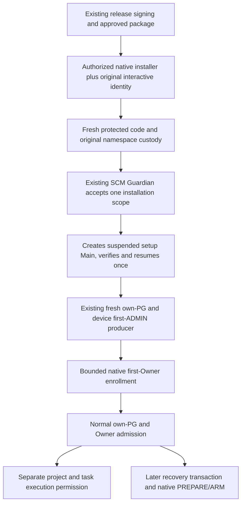

# Fresh MAIN authority: installation first, admission afterwards

Status: **source/design checkpoint, not an implemented first-launch protocol**.
Reviewed source: `3f86445a819c5b011ea300598ee0e8f4f3b86280`, tree
`616c15e2040a4087392e9a00998ef9d08ce5d282`. Fresh-bootstrap implementation owner:
thread `01a194c2-5ed5-740b-8ed2-2283dfc0700e`. This specifies its interfaces to
native custody without duplicating its installer/PG implementation.

The original installation transaction may authorize the fixed verified setup UI,
fresh infrastructure setup and bounded first enrollment. It does not grant a
project, task, agent or worker effect. Those require the existing independent
own-PG/Owner/project admission afterwards. No project ID is synthesized from
userData, paths, an installation UUID or a Windows session.

## The acyclic execution chain

Neither RootSession nor the `.node` observer is an incoming edge of first Main.
The installer and existing service execute native code already; they can bind
their original pipe/process/file/SCM identities directly, without a Node module
in a not-yet-started child. First setup does not wait for the new observer.
Current source only calls that loader from recovery `requestRelaunch()`, after
the recovery barrier; fresh-provider setup does not call it. Keep the current
module-load HOLD until its genuine load producer exists. A SOURCE_ONLY/HOLD
observer result cannot become proof that the first Main executed safely.

## Actual producers and missing edges

| Existing source anchor | Actual behavior and boundary |
| --- | --- |
| `browser-guardian-machine-bootstrap.cpp:installEmbedded` | Hashes embedded service/configurator/manifest, checks elevation, writes fresh protected machine files, starts/reads SCM. It does not authenticate a final Browser release, capture the pre-UAC interactive user, create Main or enroll Owner; receipt says `owner_enrolled:false`. |
| NSIS `runAfterFinish`, `main-entry.mjs` fresh branch | Currently starts ordinary Main directly. This bypasses the proposed native first-Main lease; replace this launch route, not its existing fresh-provider producer. |
| `setupInstalledFreshProvider` / `provisionFreshClientProvider` | Existing verified bundle, native consent, own PG17 provisioning and protected device/first local ADMIN. Requires a packaged primary and safeStorage; no prior Guardian Owner/project/goal is needed. |
| `createFreshInstalledDeviceIdentity` | Obtains actual packaged Electron Main/app/safeStorage after native consent; existing identity `ensure()` is invoked by the owning fresh operator. It does not require RootSession or a prior device ID. |
| `OwnerEnrollmentStore::createIfAbsent` | Protected persistence only: SID, evidence digest, key fingerprint. The store encodes no PG epoch, device ID or project authority. |
| Legacy `ownerEnrollmentEvidence` / ticket redemption | Distinct ADMIN-ticket issuer purpose. Evidence binds ticket/client/device/admin epoch; redemption remains `LOCAL_OWNER_BRIDGE_REQUIRED`. Keep this route and checks unchanged. |
| `ownerAndClientExact`, device proof, RootSession | Require a protected valid Owner tuple, actual OS client and P-256 proof. These are post-enrollment consumers, unsuitable as first-install issuers. |
| `probeProductionReleaseProofW77` | Explicitly blocked on real existing-root signing and authenticated detached placement. Embedded hashes or UAC alone do not fill this gap. |

## Minimal private native interfaces

These specify ownership, not public wire methods or new capability constructors.
They are not `BeginInstall(json, verified)` APIs. The actual service/actuator
protocol still needs the design checkpoint and stop-owner coordination before
implementation.

| Private operation | Real producer/consumer and refusal |
| --- | --- |
| Qualify installation | Native installer/bootstrap validates the approved release, source, signer and final payload from original retained handles, using the existing root and real installation consent. Produces an internal move-only installation scope bound to original installer PID/full birth and release identity. Missing signatures/policy/placement or foreign/ambiguous prior state is HOLD. |
| Bind intended user | Retain the actual unelevated installer process and primary token before UAC. Pair actual native installer connections after service start; Guardian independently observes SID/session/AuthenticationId and matches its WTS token for that exact session. Derive KnownFolders from that token. No elevated-admin APPDATA, active-console guess or caller session JSON. |
| Accept original install custody | Authenticate the exact new SCM Guardian through the original native pipe and retained process/birth/image. Guardian consumes the protected one-use intent and physically duplicates/checks original handles while installer retains them. JSON markers, handle numbers and reopened PIDs are only transport hints; unknown transfer preserves ownership and HOLD. |
| Create first setup Main | Guardian consumes that scope and original stop admission, selects only the held fixed EXE/normal argv/cwd and fresh native allowlist environment, creates suspended child atomically in its owned Job, journals and rechecks exact PID/full birth/token/session/logon/image/namespace, then resumes once. Any active Main slot, drift, STOP or uncertain effect refuses another create/resume. |
| Bind first Owner | Only an actual completed message from that retained setup Main/token/Job can use its installation lease and one CNG challenge for a separate first-enrollment purpose. The existing fresh operator first creates/verifies own PG and the existing device/first ADMIN. Its already loaded enrolled P-256 identity then signs the bounded bootstrap proof. Native CAS/readback joins original install/child evidence; no SQL JSON or new key self-authorizes the record. |
| Finish installation | Native custody independently joins actual child/Job, protected tuple and code. The genuine fresh operator independently verifies own PG/system identifier/schema/first ADMIN and health. Preserve native process/namespace ownership into a real normal lease. UI text, success JSON, a port, bootstrap.ready or exit zero is not readiness or task authority. |

Prefer Guardian creating the first Main itself after accepting original install
custody. This avoids installer-created child handles that are supposedly
transferred by JSON. Cross-process transport of original installer/payload
handles must duplicate into the authenticated service, validate actual object
identity and preserve both owners across before/after fences. Do not export
token or Job handles to Browser or use blanket installer shutdown waits.

An oplock's pending IRP and its OVERLAPPED/event buffers belong to the requesting
process; `DuplicateHandle` does not transfer that request storage. Keep continuous
deny-write/delete custody, cancel/join the producer request while its storage is
alive, establish the recipient's own checked request state, and only then release
the producer's ownership. A duplicated file handle or remote number alone is not
successful oplock/custody transfer. This transition needs actual Windows tests.

The pre-UAC native installer/helper remains alive while the elevated bootstrap
deploys Guardian. After service start, Guardian authenticates that original
installer as an actual pipe client, opens its exact process/token itself or
duplicates its original handles and compares them with independent OS readback.
The elevated bootstrap separately authenticates under the same one-use protected
transaction. Do not assume `ShellExecuteEx` returns PROCESS_DUP_HANDLE access or
that arbitrary handles inherit across UAC.

An ordinary elevated admin process cannot assume `WTSQueryUserToken` is available:
it requires LocalSystem and SeTcb, matching the existing Guardian context.
Credential UAC can change account; even a linked token can belong to the
credentialed administrator rather than the intended user. Already-elevated
startup without an independently bound original user is
`TARGET_USER_BINDING_REQUIRED`, not a guessed target. No LogonUser/new OS
credentials or extra privilege enablement is needed.
[WTSQueryUserToken](https://learn.microsoft.com/en-us/windows/win32/api/wtsapi32/nf-wtsapi32-wtsqueryusertoken),
[DuplicateHandle](https://learn.microsoft.com/en-us/windows/win32/api/handleapi/nf-handleapi-duplicatehandle).

The existing Browser path can remain under the intended user's fixed
`LocalAppData/Programs/METAENGINE Browser Test`. The installer must protect the
code subtree **at creation before exposure**, retain its ancestors and original
files, and keep mutable userData/PGDATA outside it. Changing ACLs on previously
user-writable code does not invalidate old writable mappings. Stage1 retains
ancestor IDs/rename custody; its immutable-code ACL gate applies to the code
subtree, not to taking ownership of the user's entire profile.

## Separate first-enrollment issuer, unchanged task authority

The installation scope is the proposed first-Owner issuer. It grants only the
initial OS-owner/device binding. Existing first-ADMIN approval stays inside the
genuine private own-PG fresh operator; the native tuple does not grant a database
epoch, project or scopes. The selected sequence is first UI, real fresh PG/device
enrollment, then native Owner binding: no pre-enrollment signing method or
weakened `device_id` check is necessary.

Use a separate canonical purpose, for example
`METAENGINE_GUARDIAN_BOOTSTRAP_FIRST_OWNER_ENROLLMENT_V1`, never the legacy ticket
domain. Bind original install/release, actual Guardian lifetime, original setup
Main PID/full birth/SID/session/logon, one native nonce, existing key fingerprint
and actual fresh client/device correlation. Archive original signed material and
durable evidence. Do not invent a numeric native Owner epoch or project ID.

Only the real fresh composition may request this narrow proof, using its already
loaded original key and an opaque native install scope. No injected signer, new
key, `ensure()`/rotation in the signing method or arbitrary Main caller. Native
service independently checks the original child; a key/signature alone cannot
admit its own issuer. Existing ADMIN-ticket evidence/redemption and enrolled
device methods remain unchanged. Later W74/project admission still requires
fresh independent own-PG ADMIN/epoch/source/Owner readback.

The installer-driven fresh composition must fence original Main/user and the
accepted installation lifetime before identity ensure, first PG mutation,
first-ADMIN approval/COMMIT and Owner-profile publication. Integrate that fence
with the existing real fresh operator; its current shutdown/profile checks are
not an authenticated native install scope. Any lost binding preserves pending
outcomes/data and stops progress. A caller-provided receipt or global boolean
cannot supply this fence, and the manual native-consent path is not silently
converted into an installation grant.

## Module loading is a separate byte-trust boundary

No `.node` is needed to authorize first Main. It is delivered as authenticated
package data. If loaded by a controlled child, its exact whole code closure must
already be held by native installer/SCM **before the child's first instruction**.
The module's later admission checks cannot repair untrusted code already loaded.

For that controlled path, keep EXE/resources/module together in the protected
code closure, with a fixed relative module path. No environment-selected
ProgramFiles path, untrusted sidecar or `bootstrap_verified` JSON may unlock
`require()`. Loading trusted verifier bytes must not require an existing Owner
or an already-admitted Main; Main admission is a subsequent native consumer.

**Co-location alone is not the missing load producer.** General direct or copied
EXE starts do not prove native custody. Before removing the current JS HOLD,
implement/qualify the actual native/OS loader rail that establishes approved
location and original immutable code custody before mapping the module,
including unowned-start handling. Separate ProgramFiles module placement needs
a genuine already trusted in-process native loader/KnownFolder primitive or an
equally qualified existing native launch composition. Current JS fs/env/W68
snapshots supply neither. This remains an additional implementation blocker,
not a logical prerequisite for first UI/identity creation and not a flag.

## Later recovery has a different original authority

Recovery starts after first setup with a real existing Main/Host generation.
Its private transaction, binding/drain and durable DISPATCH_INTENT mint the
later purpose. Authentic readback of the actual connected server is mandatory
before planned quit; a one-use native suspended-child lease permits resume only
after the original Main exits. It uses the existing enrolled device key, not an
installer scope/ticket.

First setup has no old Main, no old live capability and no recovery ticket.
Both purposes share retained namespace/executor primitives and one active-Main
fence, but have distinct issuer scopes, purposes, journals and transitions.
Neither grants task/goal execution. Missing module load or PREPARE/ARM stays HOLD
on later recovery; it does not make first installation depend on recovery.

## Actual external signing and build-order prerequisites

1. Existing protected Ed25519 release signer matching the packaged root; W77
   reports its real interface absent. No new root/key, injected signer, RFC/test
   positive or editable manifest can replace it.
2. Approved source/run, independently verified SLSA/artifact bytes, actual
   Authenticode publisher, retained-handle bytes and active release/rollback
   policy. UAC grants the operation, not release provenance. Native signer
   checks must use the same original handle/bytes; the Windows contract permits
   an open file handle, but implementation and Windows qualification remain
   required. [WINTRUST_FILE_INFO](https://learn.microsoft.com/en-us/windows/win32/api/wintrust/ns-wintrust-wintrust_file_info).
3. Acyclic build order: freeze native payloads, build bootstrap, package Browser,
   build/sign installer, then final detached authorization and authenticated
   placement. Bootstrap already embedded in Browser cannot embed/hash that final
   Browser closure; Guardian embedded in bootstrap cannot embed bootstrap's final
   digest; installer cannot embed a manifest containing its own final SHA256.
4. Generic existing-root native verification of retained final signed inventory
   and installer-owned payload, with authenticated external sidecar placement.
   Paths/detached JSON remain untrusted until verification. W77 explicitly says
   placement and immutable verified artifact handoff are not yet wired.

## Implementation and acceptance still required

Replace ordinary NSIS run-after-finish with native setup launch; add pre-UAC
identity custody, authenticated installation handoff, service-owned first-Main
lease, separate bounded first-Owner issuer and genuine module-load producer.
These are missing implementations at this checkpoint, not existing capabilities.
Reuse the fresh operator and its real consent; do not add skipConsent or receipt
shortcuts. Installer-driven consent propagation needs its own opaque native
installation scope in that producer.

| Implementation owner / existing section | Minimal concrete change |
| --- | --- |
| Fresh-bootstrap owner: NSIS `installer.nsh`, builder `runAfterFinish` | Use the existing native installer context (its System plugin already invokes native APIs) to retain pre-UAC process/token identity and remain alive through native installation handoff. Invoke verified setup launch after payload commit, not the pre-extraction `customCheckAppRunning` gate. Replace direct ordinary run-after-finish only when that producer is implemented/qualified. The requireAdministrator bootstrap cannot capture pre-UAC identity retroactively. |
| Native bootstrap: `installEmbedded`, bootstrap build binding | Add private installation qualification and actual original-user/handle handoff to the exact new service. Keep generic existing-root verification; do not embed final Browser/installer hashes back into their own build dependencies. |
| Custody / stop owner: `updateActuatorWorker`, service-owned lifetime and original admission | Route a separate fixed native-install purpose to a private fresh-install lease before post-enrollment RootSession. Guardian owns first child creation/Job/namespace, one active-Main fence and stop/uncertainty handling. Preserve status/OBSERVE-order corrections and installer effect ownership. |
| Fresh-provider owner: `setupInstalledFreshProvider`, real `provisionFreshClientProvider` | Join original Main/user/install lifetime at mutation fences; reuse actual consent, own PG, first device/ADMIN and health. The existing safeStorage producer remains the only device-key creator. |
| Custody plus fresh-provider identity owner: bounded first-Owner proof | Add the reviewed separate enrolled-key bootstrap purpose and protected CAS/readback under the actual install/child lease. Do not change legacy ticket redemption, native Owner record shape or project/epoch authority. |
| Native loader/build owner: fixed peer module loading | Deliver exact module bytes in protected closure; implement real pre-mapping native/OS custody including unowned starts. Keep current `NATIVE_LOAD_CUSTODY_UNAVAILABLE` meanwhile. |

Clean Windows acceptance must prove initial absence of METAENGINE state and
preinstalled PG/Node/Git/CLI dependencies, run the exact signed installer and
observe actual first launch/enrollment/PG/Guardian health. Include credential UAC
as another account, competing installs, copied Main/module paths, old writable
mappings, forged/replayed install/device responses, partial transfer, STOP before
resume and interrupted enrollment. Preserve original receipts/data/handles on
failure. This contract removes a logical cycle; it does not claim completed
implementation, installation readiness or full V8 attestation.
